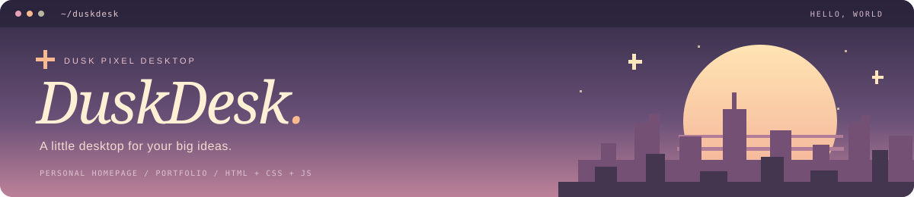
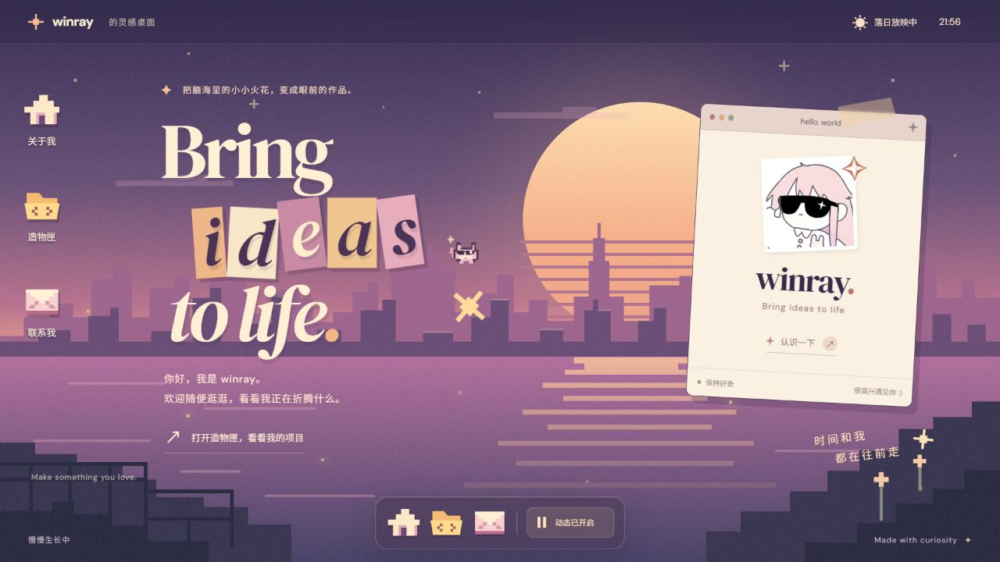
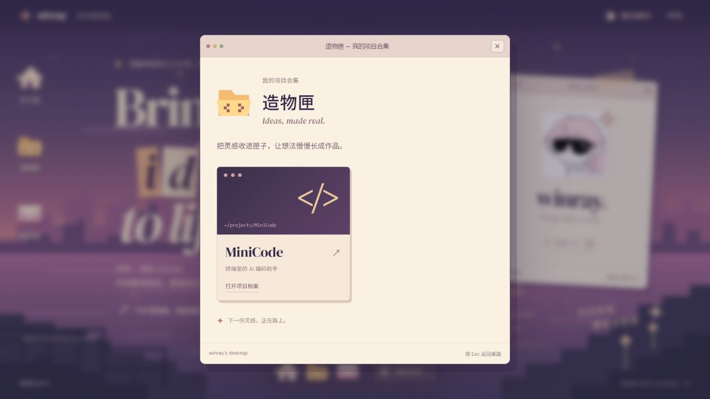
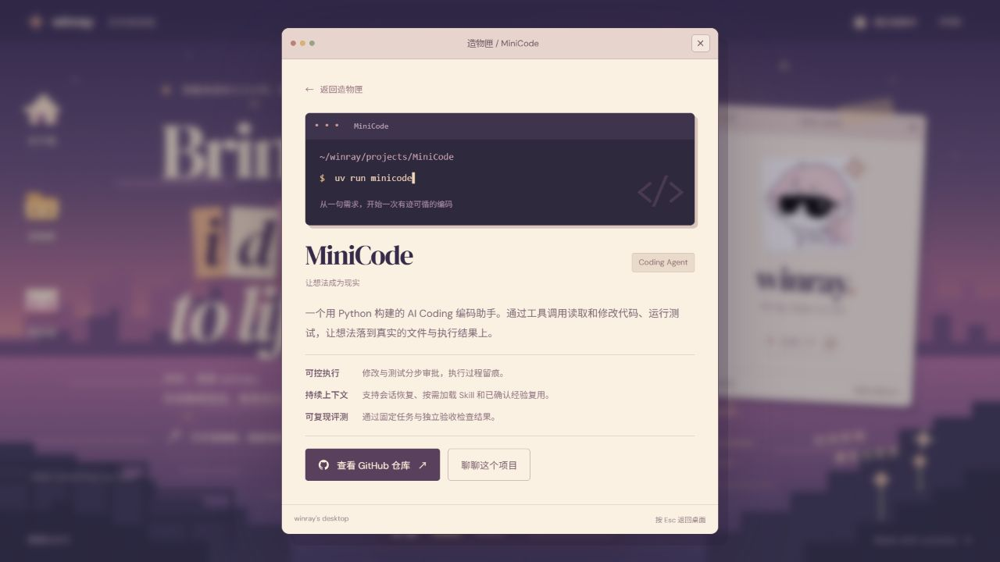

简体中文 | [English](README.en.md)

> [!IMPORTANT]
> 使用前请修改 [`site.config.js`](site.config.js) 并替换头像，填写你自己的个人资料与项目。
> [winray.cc](https://winray.cc) 是我的个人站演示；模板运行页提供通用占位内容。

<p align="center">
  
</p>

<h1 align="center">DuskDesk</h1>
<p align="center">
  <strong>暮色像素桌面风 · Dusk Pixel Desktop</strong><br>
  一个装得下作品、灵感和一场落日的个人主页模板。<br>
  Personal Homepage · Personal Website · Portfolio Template
</p>

<p align="center">
  <a href="https://winray.cc">✦ 在线体验</a> ·
  <a href="#开始使用">开始使用</a> ·
  <a href="docs/使用手册.md">使用手册</a> ·
  <a href="#个性化配置">个性化配置</a>
</p>

---

## 先看一场落日

**winray 的灵感桌面** · [winray.cc](https://winray.cc)

[](https://winray.cc)

<p align="center"><sub>点击图片进入实站，打开桌面图标，看看作品与灵感藏在哪里。</sub></p>
<details>
<summary><strong>✦ 展开看看：造物匣与项目详情</strong></summary>

### 打开造物匣

用项目卡片收纳作品，点击后进入各自的详情窗口。



### 看看一个想法如何落地

每个项目都有自己的介绍、亮点和外部链接入口。



</details>

## 关于 DuskDesk

DuskDesk 是一个用 **原生 HTML / CSS / JavaScript** 编写的个人网站模板，适合展示个人介绍、项目作品与联系方式。只做风格分享，无需安装前端依赖，无需构建，下载后即可在浏览器中打开。

| ✦ 桌面里的细节 | 你可以用它做什么 |
| --- | --- |
| **暮色像素场景** | 紫粉渐变、落日、城市天际线与像素装饰，组成完整的视觉主题 |
| **桌面与窗口交互** | 桌面图标和底部 Dock 打开关于我、项目合集、项目详情及联系方式 |
| **集中填写资料** | 在 `site.config.js` 中维护昵称、头像、简介、项目与联系入口 |
| **自由增删项目** | 一份配置生成项目卡片和详情窗口，支持多项目和空列表 |
| **轻量动态** | 屋顶小猫、流星、微光、点击粒子，可统一暂停，并响应系统减少动态偏好 |
| **横屏与竖屏布局** | 按视口调整构图，弹窗内容独立滚动，支持 Esc 关闭与焦点恢复 |

## 开始使用

### 01 · 下载，打开

下载本仓库的 ZIP 并解压，用浏览器打开根目录下的 **`index.html`**。Windows 用户也可以双击 `start-preview.cmd`。

不需要先运行 `npm install`，也没有构建步骤。

### 02 · 换成你的故事

用文本编辑器打开 **[`site.config.js`](site.config.js)**。在原有配置对象中修改对应字段，其他配置保留：

```js
name: '你的名字',
pageTitle: '你的名字 — 我的灵感桌面',
description: '分享我的作品、想法与正在探索的事物。',
avatar: 'assets/avatar.jpg',
avatarAlt: '我的个人头像',
tagline: 'Bring ideas to life',

about: {
  motto: '把想法，变成可以触摸的作品。',
  bio: '你好！在这里介绍你的兴趣、经历，以及正在创造的东西。',
},

contact: {
  intro: '关于项目，关于灵感，或者只是打个招呼。',
  github: 'https://github.com/your-username',
  email: 'hello@example.com',
  note: '期待与你交流。',
},
```

将自己的头像放入 `assets/`，让 `avatar` 与实际文件名一致。保存后刷新页面，首页名片和关于我窗口会同步更新。

### 03 · 装进你的作品

编辑配置中的 `projects` 数组。每个对象对应一张项目卡片与一个详情窗口：

```js
projects: [
  {
    name: '我的作品',
    summary: '用一句话介绍这个项目',
    caption: '~/projects/my-project',
    tag: 'Web / Design',
    description: '介绍你解决的问题、实现方式，以及真实完成的成果。',
    highlights: [
      { title: '项目亮点', text: '分享一个最值得被看见的特点。' },
      { title: '实现方式', text: '介绍实际使用的技术或设计思路。' },
    ],
    url: 'https://example.com',
  },
],
```

复制对象即可添加项目，删除对象即可移除项目；数组顺序就是展示顺序。没有作品时可设为 `projects: []`，页面会显示等待新作品的提示。

**需要更详细的逐步说明？** 查看 [完整中文使用手册](docs/使用手册.md)，包含字段说明、头像替换、项目管理、主题修改、部署和常见问题。

## 个性化配置

| 想修改什么 | 修改哪里 |
| --- | --- |
| 姓名、标签页标题、简介、名片文案 | `site.config.js` 中的基本字段 |
| 头像 | 将图片放入 `assets/`，修改 `avatar` 与 `avatarAlt` |
| 关于我 | `site.config.js` → `about` |
| 项目与作品 | `site.config.js` → `projects` |
| GitHub 与邮箱 | `site.config.js` → `contact`；留空时隐藏相应入口 |
| 海报大标题与装饰文案 | `index.html`；修改标题时同步调整 `aria-label` |
| 主题色、字体与组件 | `style.css`；主题变量位于 `:root` |
| 布局与动画 | `layout.css` |
| 网站图标 | `assets/favicon.svg` |

`tagline` 用于名片和关于我；首页的 **Bring ideas to life** 是单独设计的拼贴标题，需要在 `index.html` 中调整。长篇介绍适合放进弹窗，首页文案建议保持简洁。

## 本地预览与部署

### 可选：用 HTTP 地址预览

如果已经安装 Node.js，在仓库根目录运行：

```sh
node server.cjs
```

打开终端打印的 **`http://127.0.0.1:4173`**，按 `Ctrl+C` 停止。`server.cjs` 仅用于本地预览。

### 后续部署

完成个性化配置后，可以通过“域名 + 云服务器”部署为自己的公开网站：

1. **准备域名与服务器**：注册域名，准备一台具有公网 IP 的云服务器，并安装 Nginx 等 Web 服务器。
2. **上传网站文件**：将下方文件上传到服务器的网站目录，例如 `/var/www/duskdesk`，保持原有目录结构。
3. **配置域名访问**：在域名 DNS 中添加指向服务器公网 IPv4 地址的 A 记录，并在 Nginx 中设置对应域名、网站目录和首页 `index.html`。
4. **启用 HTTPS**：在服务器安全组与防火墙中放行网站需要的 80 / 443 端口，配置 SSL/TLS 证书，检查域名是否可以正常访问。

<details>
<summary><strong>文件结构</strong></summary>

```text
.
├── LICENSE                   MIT 许可证
├── README.md                 中文项目介绍
├── README.en.md              English README
├── index.html                页面结构与窗口模板
├── site.config.js            个人资料与项目配置
├── personalize.js            将配置填入页面
├── app.js                    窗口、时钟与动态交互
├── style.css                 主题与基础样式
├── layout.css                布局与动画
├── assets/                   网站运行素材
│   ├── avatar.svg            通用像素头像
│   └── favicon.svg           网站图标
├── docs/
│   ├── 使用手册.md           完整使用说明
│   └── images/               README 横幅与实站截图
├── server.cjs                可选的本地预览服务
└── start-preview.cmd         Windows 快速打开入口
```

</details>

## 一点使用提示

- 配置中的文字按纯文本显示，不需要填写 HTML。GitHub 和项目网址使用完整的 `https://` 或 `http://` 地址。
- GitHub、邮箱或项目链接留空时不会生成对应的外部入口。邮箱通过设备的邮件客户端打开。
- 样式使用 Google Fonts 增强排版，网络不可用时回退到系统字体。无需额外安装字体即可使用。
- 修改后刷新浏览器，再检查手机尺寸与各个窗口。更多排查方法见 [使用手册](docs/使用手册.md#9-常见问题)。

## 许可证

本项目采用 [MIT License](LICENSE)，版权所有 © 2026 winray。允许使用、修改、分发和商业使用；分发副本或实质性部分时，须保留原版权声明与许可证。完整条款见 `LICENSE`。

---

<p align="center">
  <strong>Make something you love.</strong><br>
  <sub>让每一个小小的想法，都有一张属于自己的桌面。</sub><br><br>
  <a href="https://winray.cc">winray 的灵感桌面</a> · <a href="README.en.md">Read in English</a>
</p>
